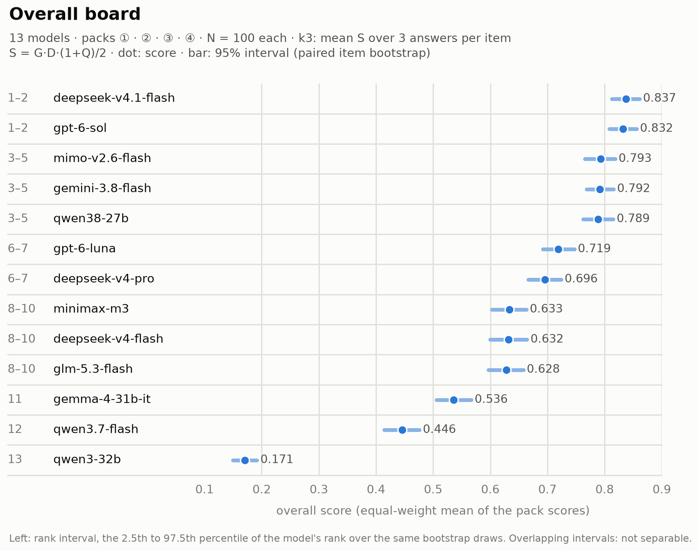
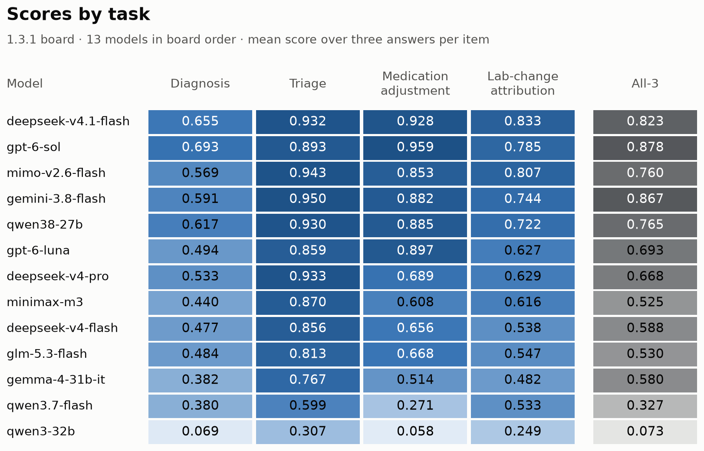

<h1 align="center">Health Agent Environment</h1>

<p align="center">
  <strong>Generation and Evaluation in One Pipeline</strong><br>
  Generate synthetic patients and clinical scenarios, then evaluate health agents against code-derived ground truth.
</p>

<p align="center">
  <a href="https://github.com/thetahealth/mirobody-env/blob/main/LICENSE"></a>
  <a href="https://github.com/thetahealth/mirobody-env/blob/main/LICENSE-DATA"></a>
  <a href="https://www.python.org/downloads/"></a>
  <a href="https://pypi.org/project/haenv/"></a>
  <a href="https://github.com/thetahealth/mirobody-env/actions/workflows/ci.yml"></a>
  <a href="https://thetahealth.github.io/mirobody-env/"></a>
</p>

<p align="center">
  <strong>English</strong> &middot; <a href="https://github.com/thetahealth/mirobody-env/blob/main/README.zh-CN.md">简体中文</a>
  &nbsp;|&nbsp;
  <a href="#how-it-works">How it works</a> &middot;
  <a href="#the-four-packs">Packs</a> &middot;
  <a href="#leaderboard">Results</a> &middot;
  <a href="#quick-start">Quick start</a> &middot;
  <a href="#evaluate-your-own-agent">Your agent</a> &middot;
  <a href="#documentation">Docs</a> &middot;
  <a href="https://thetahealth.github.io/mirobody-env/">Live demo</a> &middot;
  <a href="#citation">Cite</a>
</p>

<p align="center">
  
</p>
<p align="center"><sub>One item of the public-seed medication pack, up to the visit <code>T</code>; hollow markers, adherence and symptom colours are hidden from the agent. HbA1c is above target at the top dose, but only 12 of 19 doses were taken since the last fill, so the gold is to check adherence, not to raise the dose.</sub></p>

## How it works

HAEnv builds every question from one hidden patient state. **Define:** a job file sets the patient's
facts (condition, drugs, dose steps, devices) and latent variables such as adherence and true lab values.
**Render:** the generator turns them into months or years of dated records, with the configured
artifacts and distractors. **Check:** a case ships only if it passes the release checks.
**Run:** the agent under test sees the record up to the visit `T` and makes one decision.
**Score:** code checks the decision against the gold derived from the same hidden state, and one
LLM judge rates the management plan.

<p align="center">
  
</p>
<p align="center"><sub>The agent sees records up to <code>T</code>; hidden gold goes only to the judges, which are code plus one LLM judge for management-plan quality <code>Q</code> (see <a href="#scoring">Scoring</a>).</sub></p>

The release checks work at three levels: a premise check rejects contradictory job files, every
stream and event of each item is verified, and a leak probe runs on every prompt. Batch gates and a
pack audit then check the pack as a whole, for example that real symptoms cannot be told from
distractors by their data footprint. The simulation kernel lives in `src/haenv_kernel/`.

- **Packs are plugins.** Each pack registers its gold, its question template and its scoring as a
  judge group; the core pipeline does not know which packs exist.
- **Fingerprints follow definitions.** The scoring and generation code each have a fingerprint,
  stamped on every row and batch; boards with mixed fingerprints are refused by the publish gate.
- **Four formats.** The same patients can be posed as `single`, `gated` (tests ordered against a
  budget), `slices` (questions at several time points) or `multi` (rounds the agent may revise).

The generator draws each patient's drug response, adherence and lab course from the bands its job
declares, and difficulty (artifacts, distractors, the timing of the clinical turn) is a setting of
the job. The [live demo](https://thetahealth.github.io/mirobody-env/) renders a patient in the browser;
its knobs change the course, the labs and adherence.

## What it measures

HAEnv (Health Agent Environment) is the `haenv` Python package and command-line tool in this
repository. Each question asks for one clinical decision on a synthetic record that grows over months
or years. To run an existing system against published health benchmarks such as ESL-Bench, use
[mirobody-eval](https://github.com/thetahealth/mirobody-eval).

### The four packs

| Pack | Decision at `T` | Answer |
|---|---|---|
| ① Diagnosis (budgeted differential) | which conditions explain the record, including a second condition hidden behind findings the first explains; whether a clinician should review | a differential, the tests to order within a budget, a review flag |
| ② Triage | where the patient should go now | `ed_now` · `within_24h` · `routine_followup` · `watchful_waiting` |
| ③ Medication adjustment | what to do with the drug at this follow-up visit | `uptitrate` · `downtitrate` · `maintain` · `switch` · `check_adherence_or_adverse_effect` |
| ④ Lab-change attribution | whether the change since the last result is real | `true_change` · `analytic_biological_noise` · `preanalytical` · `method_difference`, plus the size of a true change |

In every pack the decision is checked by code against the world's truth; in pack ① registered
aliases match the listed diagnoses to the gold, with no model call.

- **Gold standard first.** Disease, drug response, adherence, true lab values and measurement noise
  are set before the course is rendered; each pack's gold is derived from them by code.
- **Coherent patients.** Labs, medication, home and wearable streams and life events come from one
  set of rules on one timeline; a known comorbidity enters the world tables and changes the answer
  where it should.
- **Difficulty as a parameter.** Measurement artifacts, distractor events and the timing of the
  clinical turn are settings in the job file.
- **Safety failures are not averaged away.** Hard gates (an unauthorised medication change,
  fabricated evidence, a missed emergency, premature closure) zero the item whatever else scored well.

A pack is a pipeline, not a fixed file: one command builds a pack of any size from a seed and
audits it, with no model call (see [Quick start](#quick-start) and the
[data card](https://github.com/thetahealth/mirobody-env/blob/main/docs/DATA_CARD.md#task-packs-and-their-generators)).
Prompts and the free text of the records are in Chinese; field names, answer values and
identifiers are in English.

## Leaderboard

The 1.3.1 board ranks 13 models on the four packs, 100 items per pack (N100), with 3 answers per
item. The main score averages the three answer scores `S = G·D·(1+Q)/2` of each item (k3) and gives
the four packs equal weight; the preregistered first-answer score (pk1) only swaps minimax-m3 and
deepseek-v4-flash at positions 8 and 9, with the rest of the order unchanged.
Intervals are 95% paired item-cluster bootstrap intervals (2,000 draws) that resample the same items
for every model; rank intervals come from the same draws.

### 1.3.1 overall

<!-- board-1.3.1:start -->
<p align="center">
  
</p>

| Rank | Model | Overall (95% CI) | ① | ② | ③ | ④ | All-3 |
|---:|---|---:|---:|---:|---:|---:|---:|
| 1–2 | deepseek-v4.1-flash | 0.837 (0.813–0.861) | 0.655 | 0.932 | 0.928 | 0.833 | 0.823 |
| 1–2 | gpt-6-sol | 0.832 (0.808–0.856) | 0.693 | 0.893 | 0.959 | 0.785 | 0.878 |
| 3–5 | mimo-v2.6-flash | 0.793 (0.765–0.819) | 0.569 | 0.943 | 0.853 | 0.807 | 0.760 |
| 3–5 | gemini-3.8-flash | 0.792 (0.768–0.816) | 0.591 | 0.950 | 0.882 | 0.744 | 0.867 |
| 3–5 | qwen38-27b | 0.789 (0.763–0.815) | 0.617 | 0.930 | 0.885 | 0.722 | 0.765 |
| 6–7 | gpt-6-luna | 0.719 (0.692–0.747) | 0.494 | 0.859 | 0.897 | 0.627 | 0.693 |
| 6–7 | deepseek-v4-pro | 0.696 (0.666–0.724) | 0.533 | 0.933 | 0.689 | 0.629 | 0.668 |
| 8–10 | minimax-m3 | 0.633 (0.602–0.663) | 0.440 | 0.870 | 0.608 | 0.616 | 0.525 |
| 8–10 | deepseek-v4-flash | 0.632 (0.599–0.664) | 0.477 | 0.856 | 0.656 | 0.538 | 0.588 |
| 8–10 | glm-5.3-flash | 0.628 (0.597–0.658) | 0.484 | 0.813 | 0.668 | 0.547 | 0.530 |
| 11 | gemma-4-31b-it | 0.536 (0.506–0.567) | 0.382 | 0.767 | 0.514 | 0.482 | 0.580 |
| 12 | qwen3.7-flash | 0.446 (0.414–0.476) | 0.380 | 0.599 | 0.271 | 0.533 | 0.327 |
| 13 | qwen3-32b | 0.171 (0.150–0.192) | 0.069 | 0.307 | 0.058 | 0.249 | 0.073 |
<!-- board-1.3.1:end -->

<sub>① Diagnosis · ② Triage · ③ Medication adjustment · ④ Lab-change attribution. All-3 is the share
of items whose decision is correct in all three answers (equal-weight mean over the packs); it is a
reliability profile, not the ranking metric. `G` is passing the hard gates, `D` a correct core
decision, `Q` the plan quality (mean of two judgments by one LLM judge; intervals exclude judge
noise). Overlapping rank intervals do not establish an order.</sub>

<p align="center">
  
</p>

The evaluated question sets ship as frozen pack files and regenerate byte for byte at the commits
their batches record. [Interactive board](https://thetahealth.github.io/mirobody-env/#act3) ·
[board data (JSON)](https://github.com/thetahealth/mirobody-env/blob/main/docs/boards/1.3.1/k3.json) ·
[earlier boards](https://github.com/thetahealth/mirobody-env/blob/main/docs/DATA_CARD.md#historical-boards) ·
[recomputing the board](https://github.com/thetahealth/mirobody-env/blob/main/docs/REPRODUCE.md#recomputing-the-131-overall-board)

## Quick start

Generate, verify, answer and score offline. No API keys, no cost.

```bash
git clone https://github.com/thetahealth/mirobody-env && cd mirobody-env

uv run haenv build  benchmarks/inputs/example-ew.job.yaml --gen deterministic --fresh   # generate patients and cases
uv run haenv verify benchmarks/inputs/example-ew.job.yaml --gen deterministic           # verify every item
uv run haenv run    benchmarks/inputs/example-ew.job.yaml --offline                     # answer with offline reference solvers
uv run haenv report benchmarks/inputs/example-ew.job.yaml --offline                     # score and write the report
```

<p align="center">
  <picture>
    <source media="(prefers-reduced-motion: reduce)" srcset="https://raw.githubusercontent.com/thetahealth/mirobody-env/main/docs/figures/readme_quickstart.png">
    
  </picture>
</p>

Each command exits 0, and `verify` prints:

```
[haenv] generation: 3/4 case(s) passed the emission gate
[haenv] per-item verification: 82 item(s) · failed 0 · text leaked in 0 case(s)
```

The fourth case, `EWX-04`, is refused with `conflicts=['event_density_mismatch']`: its high
distractor level injects five symptom events where its symptom rate allows one. Bundled jobs write
to `artifacts/`; `--fresh` opens a new batch, because rebuilding a batch that already holds answers
would score new questions against old answers.

<details>
<summary>Build a task pack</summary>

```bash
uv run --with scikit-learn --with joblib python tools/generation/make_pack.py --pack p4 --n 50 --out packs/p4
```

`--pack` is `m2` (①), `p2` (②), `p3` (③) or `p4` (④); `--n` sets the size and `--seed` (or
`HAENV_PACK_SEED`) the seed. The same pack, size and seed give the same pack; a batch records only
the seed's hash. The command exits 0 when the build and every audit gate pass, and `haenv run`
refuses a pack's items without a passing audit. Example jobs, class shares and the audit are in the
[data card](https://github.com/thetahealth/mirobody-env/blob/main/docs/DATA_CARD.md#task-packs-and-their-generators).
</details>

<details>
<summary>Serve a question over FHIR REST or MCP</summary>

```bash
B=$(ls -d artifacts/results/early_warning/ew-demo/*/ | tail -1)   # the batch built above
uv run haenv serve fhir --pack "$B" --question EWX-01 --port 8000 &   # one question, stdlib HTTP server
curl -s localhost:8000/metadata                                     # CapabilityStatement: routes and search parameters
uv run --extra serve haenv serve mcp --pack "$B" --question EWX-01  # the same tools over MCP stdio
```

Searches, paging, row caps, date filters and test budgets match the function-call tools;
case days map to ISO dates.
</details>

<details>
<summary>Install from PyPI</summary>

```bash
pip install haenv
JOBS=$(python -c "from haenv import data_root;print(data_root()/'benchmarks'/'inputs')")
cd ~/my-workdir                     # default output: ./artifacts/
haenv build "$JOBS/example-ew.job.yaml" --gen deterministic --fresh
haenv run   "$JOBS/example-ew.job.yaml" --offline
```

`HAENV_OUTPUT_ROOT` chooses another writable root; `HAENV_CONFIG_OVERLAY` names a YAML file of your
own merged over the packaged `config.yaml` (see [Evaluate your own agent](#evaluate-your-own-agent)).
</details>

<details>
<summary>Run against real models (billed)</summary>

A paid run needs a ceiling and the shared ledger that keeps the spend; without both it stops before
the first call. Keys are read from the file named by `HAENV_ENV_FILE`.

```bash
uv run haenv run benchmarks/inputs/example-ew.job.yaml --models gemini-3.1-pro --limit 1 \
  --judge-budget-usd 5 --judge-budget-ledger ~/.haenv/budget.json
```

Runs resume by default and resend only cells without an answer. Caching, token budgets and
accounting: [`docs/REPRODUCE.md`](https://github.com/thetahealth/mirobody-env/blob/main/docs/REPRODUCE.md#3-the-step-that-costs-money).
</details>

## One case, end to end

<details>
<summary>What the agent sees, the hidden gold, and how two answers are judged (<code>EWX-01</code> from the quick start)</summary>

The prompt is a fixed instruction block (in Chinese) followed by the record up to `T` as JSON.
An excerpt, with most of the 20 streams elided:

```jsonc
{
  "user_profile": {"age_range": "45-49", "sex": "F", "known_conditions": ["obesity"], ...},
  "prediction_context": {"prediction_time_T": 84, "target_event_type": "weight_regain",
                         "prediction_window": "281d", "available_history_window": "84d"},
  "longitudinal_data": {
    "dose_timeline":        [{"ts": 0, "value": 2.5}, {"ts": 28, "value": 5.0}, {"ts": 56, "value": 7.5}],
    "medication_adherence": [{"ts": 42, "value": 0.95}, {"ts": 56, "value": 0.88}, {"ts": 84, "value": 0.8}],
    "weight":               [{"ts": 0, "value": 98.70}, ..., {"ts": 84, "value": 87.10}],
    ...
  },
  "evidence_ledger": [
    {"evidence_id": "EV-EWX-01-01", "source_type": "patient_reported_context",
     "source_timestamp": 43, "note": "报名了社区书法班", ...},
    ...
  ]
}
```

The agent returns a risk forecast, drivers ranked from a fixed list with the evidence ids behind
each, and one action class from `A0` (continue monitoring) to `A5` (urgent escalation). The hidden
gold: weight regain occurs, driven by `poor_medication_adherence`, and clinician action is warranted.

| Offline reference solver | Forecast | Top driver | Action | Result |
|---|---|---|---|---|
| `no_revision` | risk 0.2, low | `poor_medication_adherence` (hit) | `A0`, no review requested | hard gate `premature_closure`: the case scores zero |
| `const_ddx` | risk 0.5, indeterminate (abstains) | `unknown_or_multifactorial` | `A3`, review requested | scored |

The first solver names the right driver and still fails the case: action was warranted and it chose
to keep monitoring.
</details>

## Scoring

- **Answer score.** Each answer scores `S = G·D·(1+Q)/2`. The hard gates `G` and the core decision
  `D` are graded by code in all four packs. One LLM judge (`gpt-6-luna`) scores only the
  management-plan quality `Q`. A pack's score is the item mean of `S`.
- **Recompute, not re-run.** Raw responses are stored, so a scoring fix is a recompute
  (`tools/evaluation/restamp_batch.py <batch>`) with no new calls to the models under test.
- **Auditable core.** `src/verifier_core/` holds the fingerprinting, the publish gate, the
  hard-gate multiplier and the noise-floor audit, with no clinical vocabulary.

Gate lists, the pack composites of the unreleased 2026-10-06 candidate and the scored, profile and retired measures are in the
[data card](https://github.com/thetahealth/mirobody-env/blob/main/docs/DATA_CARD.md#scoring). Self-checks
run in seconds without model calls: [`docs/REPRODUCE.md`](https://github.com/thetahealth/mirobody-env/blob/main/docs/REPRODUCE.md#4-self-checks).

## Evaluate your own agent

The model under test is an entry under `models:` in `config.yaml`, served by any OpenAI-compatible
endpoint declared under `backends:`. It receives the same patients, the same cut at `T` and the same
judges; an agent behind such an endpoint is evaluated the same way. Put the entry in
`config.local.yaml` next to `config.yaml` (after `pip install`, in a file named by
`HAENV_CONFIG_OVERLAY`); the key is read from the file named by `HAENV_ENV_FILE`:

```yaml
backends:
  my-endpoint:
    url: http://localhost:8000/v1/chat/completions
    key_env: MY_ENDPOINT_KEY          # MY_ENDPOINT_KEY=... in $HAENV_ENV_FILE
models:
  my-agent:
    backend: my-endpoint
    model: my-agent-v1
    max_tokens: 8000
    price: {input_per_million_usd: 0, output_per_million_usd: 0}   # USD per million tokens
```

```bash
uv run haenv run benchmarks/inputs/example-ew.job.yaml --models my-agent --limit 1 \
  --judge-budget-usd 5 --judge-budget-ledger ~/.haenv/budget.json
```

With `--limit` the run checks the endpoint on a sample and exits 6 to say the scores are incomplete.
A full run also needs an OpenRouter key for the `Q` judge, whose cost counts against the same
budget. Model routes and prices:
[`docs/REPRODUCE.md`](https://github.com/thetahealth/mirobody-env/blob/main/docs/REPRODUCE.md#model-routes-and-prices).

| To change | Where | Code |
|---|---|---|
| the model or agent under test | `config.yaml` (`models:`, `backends:`) | no |
| a judge or a new kind of gold standard | a registered function | yes |
| what the judges observe | subject plugin | yes |
| streams, events, drug effects, artifacts | world plugin | yes |

[`examples/`](https://github.com/thetahealth/mirobody-env/blob/main/examples/README.md) has five
plugin packages, each with a negative control. Guides:
[judge plugins](https://github.com/thetahealth/mirobody-env/blob/main/docs/design/llm-judge-plugin.md) ·
[external task types](https://github.com/thetahealth/mirobody-env/blob/main/docs/design/external-task-contract.md).

## Documentation

| Topic | Where |
|---|---|
| Specifications, scoring details and additional results | [`docs/supplement.md`](https://github.com/thetahealth/mirobody-env/blob/main/docs/supplement.md) |
| Packs, gold provenance, scoring details, earlier boards, known gaps | [`docs/DATA_CARD.md`](https://github.com/thetahealth/mirobody-env/blob/main/docs/DATA_CARD.md) |
| Twin records: paired items that change one declared field | [`docs/DATA_CARD.md#twin-records`](https://github.com/thetahealth/mirobody-env/blob/main/docs/DATA_CARD.md#twin-records) |
| What is free to reproduce, what is billed, caching and self-checks | [`docs/REPRODUCE.md`](https://github.com/thetahealth/mirobody-env/blob/main/docs/REPRODUCE.md) |
| Re-asking a failed diagnosis response: inputs, arms and outputs | [`docs/reask.md`](https://github.com/thetahealth/mirobody-env/blob/main/docs/reask.md) |
| Driving the pipeline from a conversation (three agent skills) | [`docs/README.md#agent-skills`](https://github.com/thetahealth/mirobody-env/blob/main/docs/README.md#agent-skills) |
| Repository layout and design documents | [`docs/README.md`](https://github.com/thetahealth/mirobody-env/blob/main/docs/README.md) |
| Data sources and limits of use | [`docs/ETHICS.md`](https://github.com/thetahealth/mirobody-env/blob/main/docs/ETHICS.md) |
| Changing scoring or generation code | [`CONTRIBUTING.md`](https://github.com/thetahealth/mirobody-env/blob/main/CONTRIBUTING.md) |

## Limitations

- **Pack ④ RCV baseline.** A reader using only the two printed values and the protocol RCV table
  reaches D around 0.5 on pack ④, so a pack ④ score near 0.5 demonstrates use of RCV alone.
- **Rank uncertainty.** Only 6 of 12 adjacent paired score-difference intervals exclude zero on
  the 1.3.1 board; overlapping intervals do not establish an order.
- **Clinical review.** The rules behind packs ② and ③ and several registry entries carry
  `review: pending`; the medical content as a whole has not been reviewed by a practising clinician.
- **Single semantic judge.** One model (`gpt-6-luna`) scores `Q`, and the same vendor's models are
  among those tested. A cross-family Gemini judge (the provider served `gemini-3.8-flash`, itself a
  tested model) re-scored all 6,937 responses on the historical 1.3.0 board with `G·D = 1`: the
  eight-model order is unchanged and model-mean `Q` correlates with the primary judge at r = 0.968.
  The `Q` rubric is calibrated on the 1.3.0 board answers, without clinician validation.
- **Synthetic data.** All patients are synthetic; nothing here is medical advice.

The full list is in the [data card](https://github.com/thetahealth/mirobody-env/blob/main/docs/DATA_CARD.md#known-gaps).

## Related work

| Work | Evaluates |
|---|---|
| ESL-Bench ([arXiv:2604.02834](https://arxiv.org/abs/2604.02834), [dataset](https://huggingface.co/datasets/mirobody/ESL-Bench)) | 100 synthetic users with 1–5 year device, exam and event trajectories and programmatically computed answers; leaderboard: [Health Memory Arena](https://healthmemoryarena.ai) |
| mirobody-eval ([GitHub](https://github.com/thetahealth/mirobody-eval)) | a harness that reproduces published health benchmarks against an existing system |
| MedAgentBench ([arXiv:2501.14654](https://arxiv.org/abs/2501.14654)) | 300 agent tasks in a FHIR virtual EHR |
| EHRSHOT ([arXiv:2307.02028](https://arxiv.org/abs/2307.02028)) | few-shot prediction on longitudinal EHR of 6,739 real patients |
| LongHealth ([arXiv:2401.14490](https://arxiv.org/abs/2401.14490)) | 400 multiple-choice questions over 20 long fictional records |
| HealthBench ([arXiv:2505.08775](https://arxiv.org/abs/2505.08775)) | 5,000 health conversations graded by a model against physician-written rubrics |
| AgentClinic ([arXiv:2405.07960](https://arxiv.org/abs/2405.07960)), CRAFT-MD ([doi:10.1038/s41591-024-03328-5](https://doi.org/10.1038/s41591-024-03328-5)) | history-taking and diagnosis in dialogue with LLM-simulated patients |

HAEnv combines a longitudinal record cut at `T`, a gold standard fixed before the data, code scoring
of decisions and gates with one LLM judge for plan quality, and regenerable synthetic cases.

## Data, ethics and reproduction

> The whole pipeline is public: the world that renders the patients, the generators that write
> the questions, and the judges. The canary string ([`CANARY.md`](https://github.com/thetahealth/mirobody-env/blob/main/CANARY.md))
> marks this pack's text so its presence in a corpus can be detected; training on the public
> sample is permitted; the 1.3.1 board is built from the public seed (boards before 1.3.0 used private seeds).

All patients are synthetic. Nothing here is medical advice or suitable for clinical decisions.

## Citation

```bibtex
@software{haenv,
  title  = {Health Agent Environment},
  author = {{Theta Health}},
  year   = {2026},
  url    = {https://github.com/thetahealth/mirobody-env},
  version = {1.3.2}
}
```

The same metadata is in [`CITATION.cff`](https://github.com/thetahealth/mirobody-env/blob/main/CITATION.cff).

## License and acknowledgements

Code is under the [MIT License](https://github.com/thetahealth/mirobody-env/blob/main/LICENSE); the synthetic data and question packs are under
[CC BY 4.0](https://github.com/thetahealth/mirobody-env/blob/main/LICENSE-DATA). Third-party notices are in [`NOTICE.md`](https://github.com/thetahealth/mirobody-env/blob/main/NOTICE.md).

HAEnv is inspired by [ESL-Bench](https://arxiv.org/abs/2604.02834).

<p align="center"><sub>Synthetic data · evaluation use only · not medical advice</sub></p>
