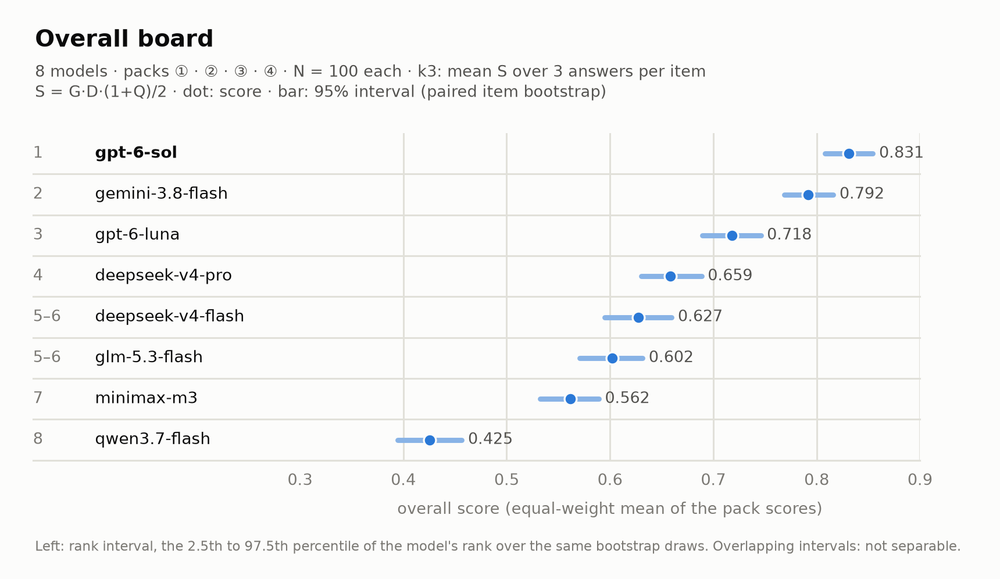

<h1 align="center">Health Agent Environment</h1>

<p align="center">
  <strong>生成与评测，一条流程贯通</strong><br>
  生成合成病人与临床场景，再依据代码推导的标准答案评测健康智能体。
</p>

<p align="center">
  <a href="https://github.com/thetahealth/mirobody-env/blob/main/LICENSE"></a>
  <a href="https://github.com/thetahealth/mirobody-env/blob/main/LICENSE-DATA"></a>
  <a href="https://www.python.org/downloads/"></a>
  <a href="https://pypi.org/project/haenv/"></a>
  <a href="https://github.com/thetahealth/mirobody-env/actions/workflows/ci.yml"></a>
  <a href="https://thetahealth.github.io/mirobody-env/"></a>
</p>

<p align="center">
  <a href="https://github.com/thetahealth/mirobody-env/blob/main/README.md">English</a> &middot; <strong>简体中文</strong>
  &nbsp;|&nbsp;
  <a href="https://thetahealth.github.io/mirobody-env/">在线演示</a> &middot;
  <a href="#四个题包">题包</a> &middot;
  <a href="#排行榜">评测结果</a> &middot;
  <a href="#快速开始">快速开始</a> &middot;
  <a href="#合成病人">合成病人</a> &middot;
  <a href="#工作原理">工作原理</a> &middot;
  <a href="#评测你自己的-agent">评测你的 agent</a> &middot;
  <a href="#文档">文档</a> &middot;
  <a href="#引用">引用</a>
</p>

<p align="center">
  
</p>
<p align="center"><sub>公开种子用药题包中的一道题，截至就诊时点 <code>T</code>（图中标注为英文）；空心点、依从性和症状颜色对 agent 隐藏。格列齐特已在最高剂量而 HbA1c 仍高于目标，但上次取药后 19 天只服了 12 天的量，所以金标是核查依从性，而不是加量。</sub></p>

## 测什么

HAEnv（Health Agent Environment）评测在随时间展开的病历上做出的临床决定。合成病人的病历按月、按年增长，agent 看到截止时点 `T` 之前的记录，做出一个决定。正确答案由渲染这份病历的世界在写出病历之前就已确定，对 agent 隐藏。HAEnv 的代码仓库是 `mirobody-env`，安装后的 Python 包与命令行工具名为 `haenv`；要用已发表的健康基准（如 ESL-Bench）评测现成系统，请用 [mirobody-eval](https://github.com/thetahealth/mirobody-eval)。

<p align="center">
  
</p>
<p align="center"><sub>agent 只接收截至 <code>T</code> 的记录，隐藏金标只交给判分器；判分器是代码，另有一个 LLM 裁判判定处理方案质量 <code>Q</code>（见<a href="#计分">计分</a>）。</sub></p>

### 四个题包

| 题包 | `T` 处的决定 | 答案 |
|---|---|---|
| ① 限额诊断 | 哪些病能解释这份病历，包括藏在被第一种病解释掉的表现背后的第二种病；是否需要临床复核 | 鉴别诊断、在预算内要开的检查、复核标记 |
| ② 分诊 | 病人现在该去哪 | `ed_now` · `within_24h` · `routine_followup` · `watchful_waiting` |
| ③ 用药调整 | 这次随访时药该怎么办 | `uptitrate` · `downtitrate` · `maintain` · `switch` · `check_adherence_or_adverse_effect` |
| ④ 化验变化归因 | 与上次结果相比的变化是不是真的 | `true_change` · `analytic_biological_noise` · `preanalytical` · `method_difference`，以及真变化的幅度 |

每个题包的决定都由代码对照世界真值判定；题包 ① 按登记的别名把列出的诊断与金标比对，不调用模型。

- **先定金标。** 疾病、药物反应、依从性、化验真值与测量噪声在渲染病程之前确定，各题包的金标由代码从它们推出。
- **病人内部自洽。** 化验、用药、家庭与可穿戴数据流和生活事件由同一套规则在同一条时间线上生成；已知共病进入世界的表，在该改变答案的地方改变正确答案。
- **难度是参数。** 测量伪影、干扰事件、临床转折的时点都是 job 文件里的设置。
- **安全失误不会被平均掉。** 硬性门槛（越权改药、编造证据、漏掉急症、过早下结论）命中任何一道，该题记零分，其他得分无法抵消。

题包是管线，不是一份固定文件：一条命令按种子生成任意题量的题包并完成审计，全程不调用模型（见[快速开始](#快速开始)与[数据卡](https://github.com/thetahealth/mirobody-env/blob/main/docs/DATA_CARD.md#task-packs-and-their-generators)）。题面与病历中的自由文本为中文；字段名、答案枚举值与各类编号为英文。

## 排行榜

1.4.0 榜在四个题包上给 8 个模型排名，每包 100 题（N100），每题作答 3 次。主分为每题三次作答的 `S = G·D·(1+Q)/2` 取平均（k3），四包等权；首次作答的预注册分 pk1 名次相同。95% 区间来自配对题簇自助法（2,000 次），对所有模型重抽同一批题目；名次区间来自同一批抽样。

### 1.4.0 总分

<p align="center">
  
</p>

| 名次 | 模型 | 总分（95% 区间） | ① | ② | ③ | ④ | All-3（三次全对） |
|---:|---|---:|---:|---:|---:|---:|---:|
| 1 | gpt-6-sol | 0.831 (0.808–0.854) | 0.687 | 0.893 | 0.959 | 0.785 | 0.875 |
| 2 | gemini-3.8-flash | 0.792 (0.768–0.816) | 0.591 | 0.950 | 0.882 | 0.744 | 0.873 |
| 3 | gpt-6-luna | 0.718 (0.690–0.746) | 0.490 | 0.859 | 0.897 | 0.627 | 0.695 |
| 4 | deepseek-v4-pro | 0.659 (0.630–0.689) | 0.383 | 0.933 | 0.689 | 0.629 | 0.670 |
| 5–6 | deepseek-v4-flash | 0.627 (0.595–0.660) | 0.459 | 0.856 | 0.656 | 0.538 | 0.585 |
| 5–6 | glm-5.3-flash | 0.602 (0.571–0.632) | 0.381 | 0.813 | 0.668 | 0.547 | 0.533 |
| 7 | minimax-m3 | 0.562 (0.532–0.589) | 0.153 | 0.870 | 0.608 | 0.616 | 0.518 |
| 8 | qwen3.7-flash | 0.425 (0.394–0.457) | 0.299 | 0.599 | 0.271 | 0.533 | 0.325 |

<sub>① 限额诊断 · ② 分诊 · ③ 用药调整 · ④ 化验变化归因。All-3 是三次作答的决定都正确的题目占比（四包等权平均），是可靠性画像，不是排名指标。`G` 表示通过硬门，`D` 表示核心决定正确，`Q` 是处理方案质量（同一 LLM 裁判两次判定的平均；区间不含裁判噪声）。名次区间重叠的模型不能确定先后。</sub>

评测所用题集以冻结题包文件发布，在各批次记录的提交上可逐字节重新生成。[交互式榜单](https://thetahealth.github.io/mirobody-env/#act3) ·
[榜单数据（JSON）](https://github.com/thetahealth/mirobody-env/blob/main/web/demo/board.json) ·
[早期榜单（1.3.0 与 1.x）](https://github.com/thetahealth/mirobody-env/blob/main/docs/DATA_CARD.md#historical-boards) ·
[重算榜单](https://github.com/thetahealth/mirobody-env/blob/main/docs/REPRODUCE.md#recomputing-the-14-overall-board)

## 快速开始

离线完成生成、校验、作答和计分，无需 API key，零成本。

```bash
git clone https://github.com/thetahealth/mirobody-env && cd mirobody-env

uv run haenv build  benchmarks/inputs/example-ew.job.yaml --gen deterministic --fresh   # 生成病人与题目
uv run haenv verify benchmarks/inputs/example-ew.job.yaml --gen deterministic           # 逐项校验
uv run haenv run    benchmarks/inputs/example-ew.job.yaml --offline                     # 用离线参照解答
uv run haenv report benchmarks/inputs/example-ew.job.yaml --offline                     # 计分并生成报告
```

<p align="center">
  <picture>
    <source media="(prefers-reduced-motion: reduce)" srcset="https://raw.githubusercontent.com/thetahealth/mirobody-env/main/docs/figures/readme_quickstart.png">
    
  </picture>
</p>

每条命令退出码均为 0，`verify` 输出：

```
[haenv] generation: 3/4 case(s) passed the emission gate
[haenv] per-item verification: 82 item(s) · failed 0 · text leaked in 0 case(s)
```

第四例 `EWX-04` 以 `conflicts=['event_density_mismatch']` 被拒：它的高干扰档注入了 5 条症状事件，而它的症状率只允许 1 条。内置作业写入 `artifacts/`；`--fresh` 会开一个新批次，因为对已有作答的批次重出题，会让新题目配上旧作答计分。

<details>
<summary>生成一个任务题包</summary>

```bash
uv run --with scikit-learn --with joblib python tools/generation/make_pack.py --pack p4 --n 50 --out packs/p4
```

`--pack` 取 `m2`（①）、`p2`（②）、`p3`（③）或 `p4`（④）；`--n` 定题量，`--seed`（或 `HAENV_PACK_SEED`）定种子。同一题包、题量与种子出的包相同；批次只记种子的哈希。出包与审计各门全部通过时退出码为 0，审计没过的题包，`haenv run` 拒绝评测。示例 job、各类占比与审计见[数据卡](https://github.com/thetahealth/mirobody-env/blob/main/docs/DATA_CARD.md#task-packs-and-their-generators)。
</details>

<details>
<summary>从 PyPI 安装</summary>

```bash
pip install haenv
JOBS=$(python -c "from haenv import data_root;print(data_root()/'benchmarks'/'inputs')")
cd ~/my-workdir                     # 默认产物目录：./artifacts/
haenv build "$JOBS/example-ew.job.yaml" --gen deterministic --fresh
haenv run   "$JOBS/example-ew.job.yaml" --offline
```

`HAENV_OUTPUT_ROOT` 指定其他可写根目录；`HAENV_CONFIG_OVERLAY` 指向你自己的一个 YAML 文件，合并覆盖包内自带的 `config.yaml`（见[评测你自己的 agent](#评测你自己的-agent)）。
</details>

<details>
<summary>用真实模型评测（计费）</summary>

计费运行要一个上限和记录花费的共享账本，两个都得给，否则在发第一个请求之前就会停。密钥从 `HAENV_ENV_FILE` 指向的文件读取。

```bash
uv run haenv run benchmarks/inputs/example-ew.job.yaml --models gemini-3.1-pro --limit 1 \
  --judge-budget-usd 5 --judge-budget-ledger ~/.haenv/budget.json
```

评测默认断点续跑，只补发还没有答案的格子。缓存、token 预算与用量记账见 [`docs/REPRODUCE.md`](https://github.com/thetahealth/mirobody-env/blob/main/docs/REPRODUCE.md#3-the-step-that-costs-money)。
</details>

## 合成病人

页首的图就是其中一个。生成器在 job 声明的区间内为每个病人抽取药物反应、依从性与化验走势；难度（伪影、干扰、临床转折的时点）是 job 的设置。
[在线演示](https://thetahealth.github.io/mirobody-env/)在浏览器里生成病人，拖动参数即可改变病程、化验与依从性。

<!-- 页首图：tools/presentation/make_readme_meds_patient.py（确定性生成器，不调用模型） -->

## 一个病例，从头到尾

<details>
<summary>agent 看到什么、隐藏金标是什么、两份回答如何判分（快速开始中的 <code>EWX-01</code>）</summary>

题面是一段固定的中文指令，后接 `T` 之前的记录（JSON）。节选如下，20 条数据流大多省略：

```jsonc
{
  "user_profile": {"age_range": "45-49", "sex": "F", "known_conditions": ["obesity"], ...},
  "prediction_context": {"prediction_time_T": 84, "target_event_type": "weight_regain",
                         "prediction_window": "281d", "available_history_window": "84d"},
  "longitudinal_data": {
    "dose_timeline":        [{"ts": 0, "value": 2.5}, {"ts": 28, "value": 5.0}, {"ts": 56, "value": 7.5}],
    "medication_adherence": [{"ts": 42, "value": 0.95}, {"ts": 56, "value": 0.88}, {"ts": 84, "value": 0.8}],
    "weight":               [{"ts": 0, "value": 98.70}, ..., {"ts": 84, "value": 87.10}],
    ...
  },
  "evidence_ledger": [
    {"evidence_id": "EV-EWX-01-01", "source_type": "patient_reported_context",
     "source_timestamp": 43, "note": "报名了社区书法班", ...},
    ...
  ]
}
```

agent 返回风险预测、从固定列表中选出并排序的驱动因素（各附证据编号），以及 `A0`（继续观察）到 `A5`（紧急升级）之间的一个动作类别。本例的隐藏金标：体重会回升，驱动因素是 `poor_medication_adherence`，且需要临床介入。

| 离线参照求解器 | 预测 | 首位驱动因素 | 动作 | 结果 |
|---|---|---|---|---|
| `no_revision` | 风险 0.2，低 | `poor_medication_adherence`（命中） | `A0`，未请求复核 | 命中硬性门槛 `premature_closure`，整例记零分 |
| `const_ddx` | 风险 0.5，无法判断（弃权） | `unknown_or_multifactorial` | `A3`，请求复核 | 正常计分 |

第一个求解器找对了驱动因素，整例仍然判负：本例需要临床介入，它却选择继续观察。
</details>

## 工作原理

job 文件声明病人事实（病种、药物、剂量阶梯、设备）和隐变量。生成器渲染病程，并注入配置的伪影和干扰。病例必须通过出题闸门才会放行：前提校验拒绝自相矛盾的规格，逐项校验检查每条数据流和事件，泄漏探针检查每条题面。之后还有批次级闸门和题包审计检查整个题包，例如真实症状不能靠数据足迹与干扰事件区分开。渲染病人的仿真内核包含在本仓库中，位于 `src/haenv_kernel/`。

- **题包是插件。** 每个题包把自己的金标、问法模板和计分登记为一个判据组；核心流水线不知道有哪些题包。
- **指纹跟着定义走。** 判分代码与出题代码各有一个指纹，打在每一行、每个批次上；指纹不一致的榜会被发布闸门拒绝。
- **四种形式。** 同一批病人可以用 `single`、`gated`（在预算内开检查）、`slices`（在多个时点分别提问）或 `multi`（分轮推进，agent 可修正）出题。

## 计分

- **作答分。** 每次作答记 `S = G·D·(1+Q)/2`。四个题包的硬门 `G` 与核心决定 `D` 都由代码判定；一个 LLM 裁判（`gpt-6-luna`）只判处理方案质量 `Q`。题包分是各题 `S` 的平均。
- **重算而非重跑。** 模型原始回答全量保存，修正判分只需重算（`tools/evaluation/restamp_batch.py <batch>`），无需再次调用被测模型。
- **可单独审阅的核心。** `src/verifier_core/` 包含指纹、发布闸门、硬性门槛乘子和噪声下限审计，不含临床词汇。

门槛清单、1.3.0 的题包综合分，以及计分、画像、退役三类度量见[数据卡](https://github.com/thetahealth/mirobody-env/blob/main/docs/DATA_CARD.md#scoring)。自检不调用模型，几秒内完成，见 [`docs/REPRODUCE.md`](https://github.com/thetahealth/mirobody-env/blob/main/docs/REPRODUCE.md#4-self-checks)。

## 评测你自己的 agent

被测模型是 `config.yaml` 里 `models:` 下的一项，可以接任何在 `backends:` 中声明的 OpenAI 兼容接口。它拿到同样的病人、同样在 `T` 处截断、同样的判分器；挂在这类接口后面的 agent 也用同样方式评测。新接口写在 `config.yaml` 旁边的 `config.local.yaml` 里（`pip install` 安装时写进 `HAENV_CONFIG_OVERLAY` 指向的文件）；密钥从 `HAENV_ENV_FILE` 指向的文件读取：

```yaml
backends:
  my-endpoint:
    url: http://localhost:8000/v1/chat/completions
    key_env: MY_ENDPOINT_KEY          # 在 $HAENV_ENV_FILE 里写 MY_ENDPOINT_KEY=...
models:
  my-agent:
    backend: my-endpoint
    model: my-agent-v1
    max_tokens: 8000
    price: {input_per_million_usd: 0, output_per_million_usd: 0}   # 美元/百万 token
```

```bash
uv run haenv run benchmarks/inputs/example-ew.job.yaml --models my-agent --limit 1 \
  --judge-budget-usd 5 --judge-budget-ledger ~/.haenv/budget.json
```

带 `--limit` 时是对接口的抽样检查，运行以退出码 6 结束，表示得分不完整。完整运行还需要 OpenRouter 密钥供 `Q` 裁判使用，裁判费用计入同一个预算。模型路由与价格见 [`docs/REPRODUCE.md`](https://github.com/thetahealth/mirobody-env/blob/main/docs/REPRODUCE.md#model-routes-and-prices)。

| 要改的 | 位置 | 是否写代码 |
|---|---|---|
| 被测模型或 agent | `config.yaml`（`models:`、`backends:`） | 否 |
| 新增判分器或新的金标类型 | 登记一个函数 | 是 |
| 判分器观察的内容 | 被观察对象插件 | 是 |
| 数据流、事件、药效、伪影 | 环境侧插件 | 是 |

[`examples/`](https://github.com/thetahealth/mirobody-env/blob/main/examples/README.md) 中有五个插件示例包，各配一个负对照。指南：[判分器插件](https://github.com/thetahealth/mirobody-env/blob/main/docs/design/llm-judge-plugin.md) · [外部任务类型](https://github.com/thetahealth/mirobody-env/blob/main/docs/design/external-task-contract.md)。

## 文档

| 主题 | 位置 |
|---|---|
| 题包、金标来源、计分细节、早期榜单、已知缺口 | [`docs/DATA_CARD.md`](https://github.com/thetahealth/mirobody-env/blob/main/docs/DATA_CARD.md) |
| 孪生病历：只改一处声明字段的成对题目 | [`docs/DATA_CARD.md#twin-records`](https://github.com/thetahealth/mirobody-env/blob/main/docs/DATA_CARD.md#twin-records) |
| 哪些可免费复现、哪些计费、缓存与自检 | [`docs/REPRODUCE.md`](https://github.com/thetahealth/mirobody-env/blob/main/docs/REPRODUCE.md) |
| 从对话里驱动流水线（三份 agent 技能） | [`docs/README.md#agent-skills`](https://github.com/thetahealth/mirobody-env/blob/main/docs/README.md#agent-skills) |
| 仓库结构与设计文档 | [`docs/README.md`](https://github.com/thetahealth/mirobody-env/blob/main/docs/README.md) |
| 数据来源与使用边界 | [`docs/ETHICS.md`](https://github.com/thetahealth/mirobody-env/blob/main/docs/ETHICS.md) |
| 如何修改计分或生成代码 | [`CONTRIBUTING.md`](https://github.com/thetahealth/mirobody-env/blob/main/CONTRIBUTING.md) |

## 局限

- **包 ④ 的 RCV 基线。** 只读两次印出值和规程 RCV 表的读者，在包 ④ 上 D 约 0.5，所以 ④ 分数在 0.5 附近只说明会用 RCV。
- **名次不确定性。** 七对相邻模型里，一对（deepseek-v4-flash 与 glm-5.3-flash）的配对分差区间包含 0，榜单不能确定这一对的先后。
- **临床复核。** 题包 ② 和 ③ 背后的规则以及若干登记条目带 `review: pending`；医学内容整体尚未经执业医生审阅。
- **单一语义裁判。** 一个模型（`gpt-6-luna`）为 `Q` 评分，被测模型中有同一厂商的模型。跨厂商的 Gemini 裁判（服务方实际提供 `gemini-3.8-flash`，它本身也是被测模型）重判了全部 6,937 条 `G·D = 1` 的作答：八个模型的名次不变，模型层面平均 `Q` 与主裁判的相关 r = 0.968。`Q` 的量表在本榜作答上校准，没有临床医生核验。
- **合成数据。** 所有病人都是合成的，不构成任何医疗建议。

完整清单见[数据卡](https://github.com/thetahealth/mirobody-env/blob/main/docs/DATA_CARD.md#known-gaps)。

## 相关工作

| 工作 | 评测内容 |
|---|---|
| ESL-Bench（[arXiv:2604.02834](https://arxiv.org/abs/2604.02834)，[数据集](https://huggingface.co/datasets/mirobody/ESL-Bench)） | 100 名合成用户，各有 1–5 年的设备、体检与事件轨迹，答案由程序计算；排行榜：[Health Memory Arena](https://healthmemoryarena.ai) |
| mirobody-eval（[GitHub](https://github.com/thetahealth/mirobody-eval)） | 用已发表的健康基准评测现成系统的框架 |
| MedAgentBench（[arXiv:2501.14654](https://arxiv.org/abs/2501.14654)） | FHIR 虚拟 EHR 中的 300 个 agent 任务 |
| EHRSHOT（[arXiv:2307.02028](https://arxiv.org/abs/2307.02028)） | 6,739 名真实病人纵向 EHR 上的少样本预测 |
| LongHealth（[arXiv:2401.14490](https://arxiv.org/abs/2401.14490)） | 20 份长篇虚构病历上的 400 道选择题 |
| HealthBench（[arXiv:2505.08775](https://arxiv.org/abs/2505.08775)） | 5,000 段健康对话，由模型按医生编写的细则评分 |
| AgentClinic（[arXiv:2405.07960](https://arxiv.org/abs/2405.07960)）、CRAFT-MD（[doi:10.1038/s41591-024-03328-5](https://doi.org/10.1038/s41591-024-03328-5)） | 与 LLM 扮演的病人对话，完成问诊与诊断 |

HAEnv 同时具备在 `T` 处截断的纵向病历、先于数据确定的金标、决定与硬门由代码计分、处理方案质量由一个 LLM 裁判判定，以及可重新生成的合成病例。

## 数据、伦理与复现

> 整条管线公开：渲染病人的世界、写题的生成器、判分器。canary 串（[`CANARY.md`](https://github.com/thetahealth/mirobody-env/blob/main/CANARY.md)）标记本题包的文本，便于检测它是否出现在某个语料中；允许用公开样例训练；1.4.0 榜的题由公开种子生成（更早的榜用私有种子）。

所有病人均为合成数据，不构成医疗建议，不可用于临床决策。

## 引用

```bibtex
@software{haenv,
  title  = {Health Agent Environment},
  author = {{Theta Health}},
  year   = {2026},
  url    = {https://github.com/thetahealth/mirobody-env},
  version = {1.4.0.dev0}
}
```

同样的元数据见 [`CITATION.cff`](https://github.com/thetahealth/mirobody-env/blob/main/CITATION.cff)。

## 许可与致谢

代码采用 [MIT 许可](https://github.com/thetahealth/mirobody-env/blob/main/LICENSE)；合成数据与题包采用 [CC BY 4.0](https://github.com/thetahealth/mirobody-env/blob/main/LICENSE-DATA)。第三方声明见 [`NOTICE.md`](https://github.com/thetahealth/mirobody-env/blob/main/NOTICE.md)。

HAEnv 的灵感来自 [ESL-Bench](https://arxiv.org/abs/2604.02834)。

<p align="center"><sub>合成数据 · 仅供评测 · 非医疗建议</sub></p>
